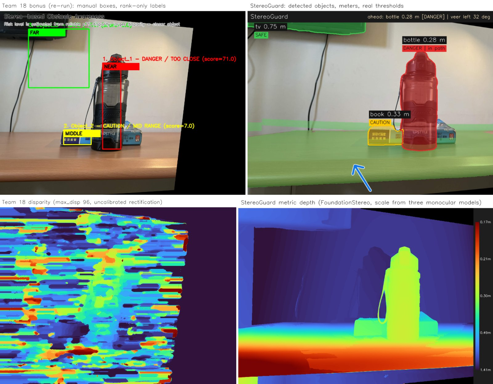
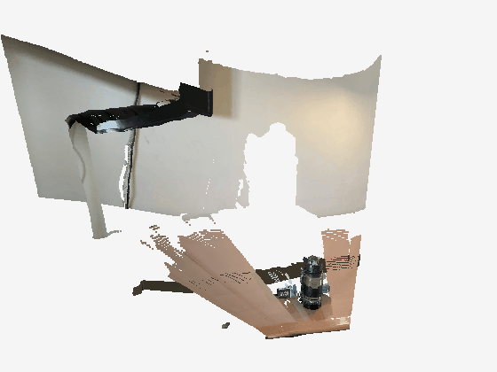
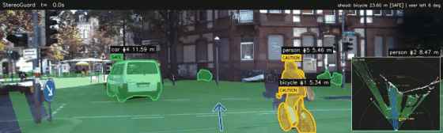
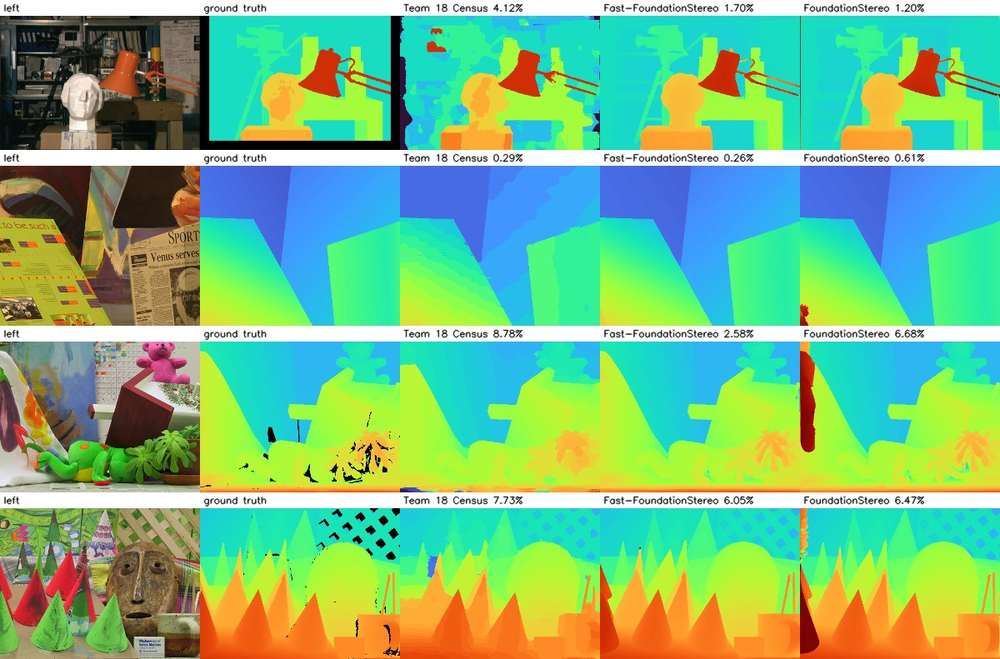
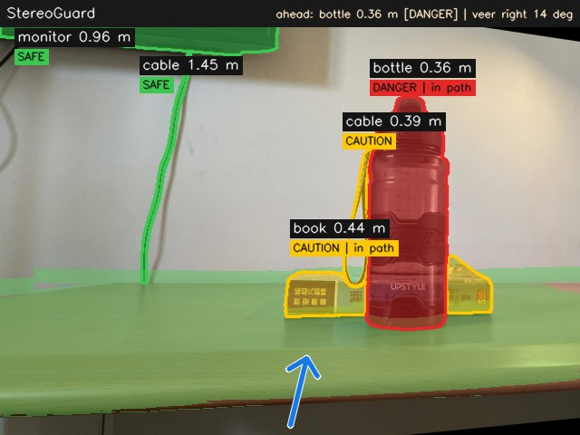
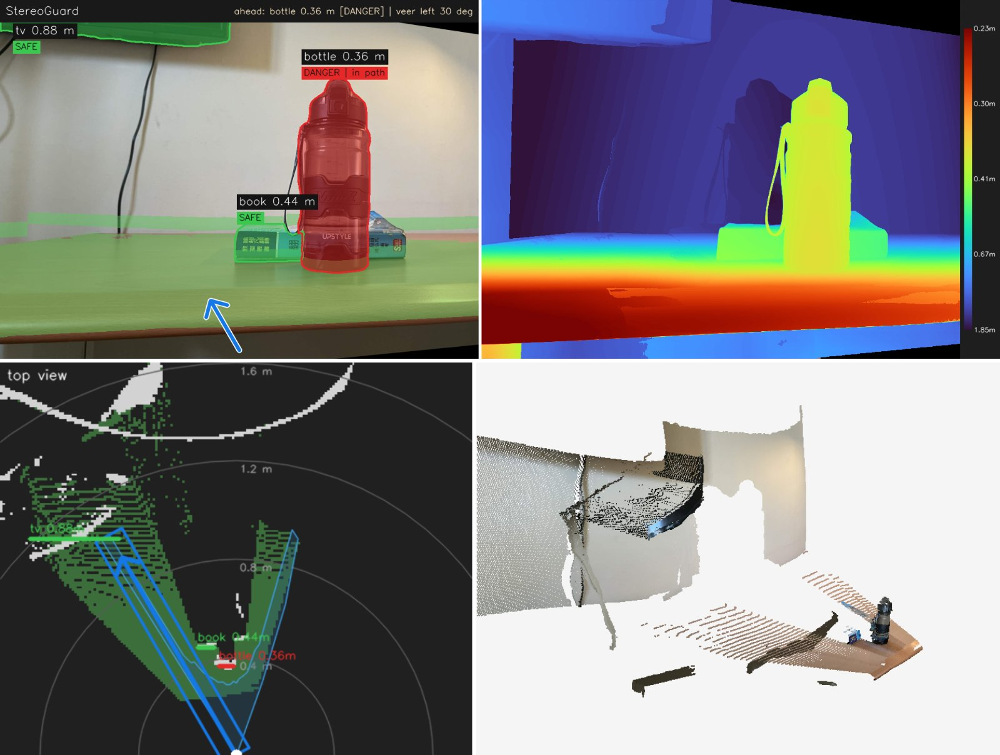

# StereoGuard：手機雙拍立體視覺避障

StereoGuard 是臺大 114-2 電腦視覺（簡韶逸老師）期末專題第 18 組作品的後續升級版。原本的 bonus
用一支手機水平移動拍兩張照片，經過特徵比對、未校正 rectification 與 Census 立體匹配後，依手動框選區域的
視差排名，把物體標成 DANGER / CAUTION / SAFE。這個版本保留「一支手機拍兩張就能感知深度」的想法，把整條
流程換成目前最新的模型並做成實際能用的應用：用預測的焦距做 calibrated rectification，以 FoundationStereo
算視差，用三個單眼公尺深度模型估計手機移動了多少、換算成公尺，自動辨識物體（也能用文字指定），依真實距離
門檻給警示並指出可以走的方向；另外支援影片的追蹤與碰撞時間（TTC）估計，以及網頁介面。每個環節都在有真值
的資料上和其他候選模型比較過，再決定用哪一個。



| 手機照片的 3D 重建 | 影片模式（KITTI 雙目影片） |
|:---:|:---:|
|  |  |

## 功能

- **自動校正**：焦距取自 EXIF；沒有 EXIF 時取 VGGT、Depth Pro、MoGe-2 三個模型預測視角的中位數。估計
  essential matrix 後做 calibrated rectification，視差全部為正，並依特徵點的視差自動決定解析度與視差偏移。
- **立體匹配**：FoundationStereo（ViT-L，CVPR 2025）為預設；Fast-FoundationStereo（CVPR 2026，ONNX）
  用在影片與沒有 GPU 的電腦；原本第 18 組的 Census matcher 保留為對照組。都會做 left-right check。
- **公尺距離**：知道手機移動幾公分就直接 Z = f·B/d；不知道時用 Depth Pro、UniDepthV2、
  Depth Anything V2 Metric 各估一次移動距離再取幾何平均，並用常見物體尺寸檢查結果是否合理。
- **物體辨識**：YOLO11-seg（COCO 80 類）為預設；開放詞彙模式用 Grounding DINO 找框、SAM 2.1 切遮罩，
  可以找「cable」「desk lamp」這類 COCO 沒有的東西。
- **依真實門檻警示**：每個物體回報距離、左右偏移、高度、寬度，依「距離 + 是否在行進路徑上（+ TTC）」
  判斷 DANGER / CAUTION / SAFE，內建桌面、步行、行車三種情境，門檻可以自己調。
- **可走方向**：RANSAC 找出地面或桌面，做俯視占據格點，再沿每個方向掃一條與身體同寬的通道，得到各方向
  能走多遠（Vector Field Histogram 的想法），給出建議方向。
- **視覺化**：AR 標示、公尺深度圖、俯視雷達圖、彩色點雲（PLY）與可旋轉的 3D 網格。
- **影片模式**：雙目影片用 Fast-FoundationStereo，單支相機的影片用 MoGe-2；ByteTrack 追蹤，計算接近
  速度與 TTC，並預測物體在碰撞時刻是否會進入路徑。
- **網頁介面**：Gradio，上傳兩張照片即可看到所有結果與 3D 網格。

## 原版 bonus 的問題

用 `bonus_run_instruction.txt` 的指令與框重跑原版（`eval/eval_phone_scene.py`），課程測資用原本的
`eval.py`：

| 項目 | 原版 bonus | 問題 |
|---|---|---|
| Rectification | ORB + F 矩陣 + `stereoRectifyUncalibrated` | 投影校正有任意水平偏移：34.9% 的匹配點視差是負的（−65 到 +49 px），左圖只剩 71.6% 有效 |
| 視差搜尋範圍 | 固定 0–96 px | 背景（牆、電視）的負視差完全搜不到，整張視差圖接近雜訊 |
| 可靠像素 | LR check + cost margin | 只剩 0.46% 的像素，瓶子的框內 2.4%、牆的框內 0.02% |
| 結果穩定性 | 同一個指令 | 文件中的排名可以重現，但換一個 Python / numpy 版本重跑，瓶子框內可靠像素降到 0.3% 被歸零，排名變成「書 = DANGER、瓶子 = CAUTION」 |
| 物體 | 手動框三個框，名稱是 Object_1–3 | 不會自動找物體，框內混到背景 |
| 警示 | 依排名：第 1 名 DANGER、第 2 名 CAUTION、第 3 名 SAFE | 沒有距離概念，5 公尺外的物體只要排第一也是 DANGER；分數為 0 的框直接變 SAFE |
| 距離 | 只有視差排名 | 未校正 + 不知道移動距離，無法換算成公尺 |
| 輸入 | 一組靜態照片 | 不能處理影片、沒有追蹤與 TTC |
| 課程測資 bad pixel | 平均 5.2%（Venus 0.3% 到 Teddy 8.8%） | 在 MiddEval3 上 bad-1.0 是 19.4%，影像校正不完美時（Playtable）掉到 43% |

## 方法

```text
左右照片 ─▶ SIFT 匹配 ─▶ essential matrix（焦距：EXIF / VGGT·Depth Pro·MoGe-2 中位數）
        ─▶ calibrated rectification ─▶ 依特徵視差決定解析度與視差偏移
        ─▶ FoundationStereo（左右各算一次做 LR check）
        ─▶ Z = f·B/d（B 已知，或 Depth Pro·UniDepthV2·DA-V2 估計）＋ 單眼深度補洞 ─▶ 尺寸合理性檢查
        ─▶ YOLO11-seg 或 Grounding DINO + SAM 2.1 ─▶ 每個物體的距離 / 左右位置 / 高度 ─▶ 警示等級
        ─▶ RANSAC 地面 ─▶ 俯視占據格點 ─▶ 各方向可走距離 ─▶ 建議方向
```

1. **Rectification**：兩張照片之間幾乎只有水平平移。已知焦距 K 後用 `findEssentialMat`（MAGSAC++）
   與 `recoverPose` 求出旋轉 R 與平移方向 t，再用 `stereoRectify` 讓兩台虛擬相機平行，視差一定是正的，
   深度可以直接寫成 Z = f·B/d；若第二張其實是從左邊拍的會自動交換。純平移在幾何上無法自我校正焦距，
   所以焦距依序取自使用者輸入、EXIF，再來才是模型預測（三個模型取中位數，避免單一模型失準）。
2. **視差範圍**：程式先看校正後特徵點的視差範圍，自動選解析度，必要時把右圖整體平移（視差偏移，
   同 Middlebury 的 doffs），讓網路只需要處理剩下的範圍。Fast-FoundationStereo 的 ONNX 只看得到約
   190 px 的視差，FoundationStereo 可到 416 px。
3. **立體匹配**：FoundationStereo 以 DepthAnything 的單眼先驗輔助 cost volume，在 Middlebury 與 ETH3D
   排行榜都是第一；兩個 FoundationStereo 模型都沒有用 Middlebury 訓練，下面的結果都是 zero-shot。
   右視差用左右翻轉的影像再跑一次，做 left-right check。
4. **公尺尺度**：B 已知時 Z = f·B/d；未知時，對每個可靠像素算 B_i = Z_mono·d/f 取中位數，三個單眼模型
   各得一個 B，再取幾何平均。若瓶子、杯子、螢幕等常見物體的尺寸明顯不合理，會在結果中提醒要量移動距離。
5. **物體距離**：遮罩先內縮 2 px 避開邊界，距離取遮罩內深度的第 20 百分位（離相機最近的表面），左右位置、
   高度與寬度在地面座標系中計算。
6. **警示規則**：物體的左右範圍和通道（桌面 ±6 cm、步行 ±35 cm、行車 ±0.95 m）重疊就算「在路徑上」。
   在路徑上且距離小於危險門檻或 TTC 小於危險時間為 DANGER，小於注意門檻為 CAUTION；不在路徑上但
   非常近也會是 CAUTION。

   | 情境 | DANGER | CAUTION | TTC（DANGER / CAUTION） | 通道半寬 |
   |---|---|---|---|---|
   | tabletop | < 0.40 m | < 0.80 m | 1.5 s / 3 s | 0.06 m |
   | walking | < 1.0 m | < 2.0 m | 1.5 s / 3 s | 0.35 m |
   | driving | < 8 m | < 15 m | 2 s / 4 s | 0.95 m |

7. **可走方向**：在點雲中用 RANSAC 找法向量接近「上」的平面，高出平面一定高度的點就是障礙物，依每個
   像素代表的面積累積到俯視格點。對視野內每個方向，沿一條與身體同寬的通道往前走，遇到障礙物或沒看過的
   地面（例如桌子邊緣）就停，再以「可走距離大、轉向小」挑出建議方向。
8. **影片模式**：每個追蹤 ID 保留最近 1 秒的距離與左右位置，用 Theil–Sen 穩健直線擬合得到接近速度
   v = −dZ/dt，TTC = Z / v（至少要有 0.5 秒的歷史）；另外用遮罩大小的膨脹率算一個不需要深度的 TTC
   （Lee 的 tau）作對照。依橫向速度預測碰撞時刻的位置，若會切進通道也算在路徑上。

## 模型比較與選擇

所有數字都由 `eval/` 的程式在同一台電腦（RTX 4060 Ti 16 GB）上產生。公尺評估用 26 個有真值深度的場景：
MiddEval3 training 15 個（quarter resolution）與 Middlebury 2021 Mobile 11 個近距離場景（手機相機裝在
機械手臂上拍攝，half resolution）。2021 另外 13 個室內大場景的 calib 基線會讓物體大小變成好幾倍（例如
artroom1 的門會被換算成約 6 公尺高），所以沒有使用。

### 1. 立體匹配

| 方法 | 課程測資 bad pixel | 只算右相機看得到的區域 | MiddEval3 bad-1.0 / bad-2.0 | 平均誤差 | 已知移動距離時的物體距離誤差 | 960×540 一組（左右兩次） |
|---|---:|---:|---:|---:|---:|---:|
| 第 18 組 Census | 5.23% | 3.95% | 19.4% / 13.2% | 2.30 px | 0.82%（1.6 cm） | 2.9 s（CPU） |
| Fast-FoundationStereo | **2.65%** | 1.76% | 5.2% / 2.7% | 0.44 px | 0.45%（0.9 cm） | **1.1 s** |
| FoundationStereo ViT-L | 3.74% | **1.32%** | **2.6% / 1.3%** | **0.30 px** | **0.36%（0.7 cm）** | 3.2 s，3.9 GB |

| 測資（課程算法） | Census | Fast-FoundationStereo | FoundationStereo |
|---|---:|---:|---:|
| Tsukuba | 4.12% | 1.70% | **1.20%** |
| Venus | 0.29% | **0.26%** | 0.61% |
| Teddy | 8.78% | **2.58%** | 6.68% |
| Cones | 7.73% | **6.05%** | 6.47% |

課程的 `eval.py` 也計算左邊那條右相機看不到的區域。FoundationStereo 在這條區域不會外插（下圖 Teddy、Cones
左側的紅色條紋），所以課程分數輸給 Fast-FoundationStereo；只看兩台相機都看得到的區域、或 MiddEval3 的
non-occluded 區域，FoundationStereo 的誤差都是最低的。應用中這條區域會被 LR check 判為不可靠、改用單眼
深度補上，因此照片模式預設用 FoundationStereo，影片模式用快三倍的 Fast-FoundationStereo。



### 2. 公尺尺度與焦距從哪裡來

手機移動距離未知時，物體距離的誤差就等於估計出來的移動距離的誤差（視差本身已經很準）。下表的「移動距離」
用 FoundationStereo 的視差與各模型的深度估計，模型都給定真實視角；「焦距」是只看照片時預測的焦距。

| 模型 | 移動距離誤差（平均 / 中位數） | 焦距誤差（全部 / 手機相機場景） | 時間 | GPU 記憶體 |
|---|---:|---:|---:|---:|
| Depth Anything V2 Metric-S | 29.5% / 24.7% | – | 0.06 s | 0.3 GB |
| Depth Anything V2 Metric-L | 23.6% / 24.6% | – | 0.24 s | 1.9 GB |
| MoGe-2 ViT-S | 53.6% / 44.0% | 26.8% / 15.3% | 0.22 s | 1.2 GB |
| MoGe-2 ViT-L | 34.4% / 24.5% | 28.7% / 18.0% | 0.42 s | 2.4 GB |
| Depth Pro | 18.9% / **10.6%** | 11.7% / 11.2% | 1.27 s | 3.9 GB |
| UniDepthV2-L | 18.5% / 15.6% | 26.5% / 19.0% | 0.19 s | 2.5 GB |
| MapAnything（兩張照片，相機位置） | 79.6% / 74.5% | 30.0% / 10.5% | 0.52 s | 9.8 GB |
| VGGT（兩張照片） | –（沒有公尺尺度） | **10.9% / 4.1%** | 0.31 s | 10.1 GB |
| **Depth Pro + UniDepthV2 + DA-V2-L 幾何平均** | **15.1% / 10.8%** | – | | |
| **VGGT、Depth Pro、MoGe-2 焦距中位數** | | 17.6%（MiddEval3）/ 7.4% | | |

- 已知移動距離時，1–3 公尺內物體的距離誤差不到 1 公分；不知道時只能靠單眼模型，誤差約 15%。
- 近距離的桌面場景對單眼模型特別難，MoGe-2 平均把距離高估約 50%；以多視角模型來說，MapAnything 的
  公尺尺度在這些場景也偏差很大，VGGT 則是焦距最準的。
- 三個模型的組合是在同一批資料上挑的，數字會略為樂觀。

### 3. 單支相機的影片深度（KITTI，LiDAR 當真值）

資料：KITTI raw `2011_09_26_drive_0005`（154 幀、約 16 秒，市區街道，車子跟在一台腳踏車後面）。每幀用
YOLO11-seg + ByteTrack 追蹤物體，把 Velodyne 點投影到影像，物體遮罩內的 LiDAR 點（至少 8 個）取第 20
百分位當真值距離；各方法在同樣的像素上取同樣的統計量。共 67 條軌跡、1081 次量測；TTC 只看真實接近速度
大於 1 m/s、真實 TTC 小於 15 秒的 488 筆，所有方法用同樣的 1 秒視窗。

| 深度來源 | 距離平均誤差 | 誤差 < 10% | 0–10 m / 10–20 m / 20 m 以上 | TTC 誤差中位數 | TTC 誤差 < 20% | 接近速度誤差 |
|---|---:|---:|---:|---:|---:|---:|
| **Fast-FoundationStereo（雙目，基線 0.53 m）** | **2.9%** | **98%** | 1.2% / 2.6% / 5.1% | **5.9%** | **88%** | **0.54 m/s** |
| MoGe-2（單張，給定視角） | 16.3% | 18% | 10.5% / 16.3% / 22.3% | 20.9% | 48% | 1.45 m/s |
| Metric Video Depth Anything-L | 28.8% | 2% | 32.9% / 26.7% / 28.0% | 24.0% | 43% | 1.82 m/s |
| Metric Video Depth Anything-S | 29.7% | 13% | 44.7% / 28.2% / 17.3% | 30.5% | 36% | 1.85 m/s |
| 遮罩膨脹率（不需要深度） | – | – | – | 31.7% | 32% | – |

Video Depth Anything 的深度在時間上很平順，但這段影片的整體尺度偏差較大，距離與 TTC 都不如逐幀的
MoGe-2，所以單支相機的影片預設用 MoGe-2。雙目深度在 40 公尺內的誤差約 1–5%，TTC 也和 LiDAR 很接近，
這也是為什麼主要模式仍然是兩張照片的立體視覺。

### 4. 物體辨識

| 偵測器 | 第 18 組照片找到的東西 | 說明 |
|---|---|---|
| YOLO11-seg | bottle、book、tv | COCO 80 類，快、穩定，預設使用 |
| YOLOE-26（開放詞彙） | bottle、book | 給「monitor、cable、desk lamp」等文字，這組照片沒找到螢幕 |
| Grounding DINO + SAM 2.1 | bottle、book、monitor、牆上的 cable、瓶子的提帶 | 遮罩最細，連細電線都能切出來；比 YOLO 慢約 1 秒 |



上圖是開放詞彙模式（提示詞：bottle, book, monitor, cable, desk lamp, wall socket），焦距與移動距離沿用下面
預設模式的結果；牆上的電線與瓶子的提帶都被當成 cable 找了出來。

## 實驗結果：第 18 組的手機照片

| 項目 | 原版 bonus | StereoGuard |
|---|---|---|
| 焦距 | 不需要（未校正） | 沒有 EXIF：VGGT 57.4°、Depth Pro 64.5°、MoGe-2 69.6°，取中位數 64.5° |
| 校正後負視差的匹配點 | 34.9% | 0% |
| 校正後垂直誤差（中位數） | 0.50 px | 0.26 px |
| 有效影像面積 | 71.6% | 97.1% |
| 視差搜尋 | 固定 0–96 px | 自動：特徵視差 106–182 px（960 px 寬），FoundationStereo 不需偏移 |
| 可靠像素（LR check） | 0.46% | 65.7% |
| 找到的物體 | 手動 3 個框 | bottle、book、tv（含遮罩） |
| 輸出 | 名次 → DANGER / CAUTION / SAFE | 瓶子 0.36 m、在路徑上 → DANGER；書 0.44 m、tv 0.88 m → SAFE；建議往左 30° |

這組照片經過通訊軟體壓縮，沒有 EXIF，也沒有記錄手機移動了多少。下表是各尺度來源估出的移動距離，以及
它換算出的瓶子距離與大小（幾何來自 FoundationStereo，只有整體比例不同）：

| 尺度來源 | 移動距離 | 瓶子距離 | 瓶子高 × 寬 |
|---|---:|---:|---:|
| Depth Anything V2 Metric-S | 10.1 cm | 0.42 m | 20 × 7.2 cm |
| Depth Anything V2 Metric-L | 10.6 cm | 0.44 m | 21 × 7.5 cm |
| MoGe-2 ViT-S | 5.9 cm | 0.24 m | 12 × 4.2 cm |
| Depth Pro | 7.9 cm | 0.33 m | 16 × 5.6 cm |
| UniDepthV2-L | 8.0 cm | 0.33 m | 16 × 5.6 cm |
| MapAnything（相機位置） | 25.9 cm | 1.07 m | 51 × 18 cm |
| **預設（Depth Pro、UniDepthV2、DA-V2-L 幾何平均）** | **8.8 cm** | **0.36 m** | **17 × 6.2 cm** |

預設的 8.8 cm 落在原本拍攝說明寫的 5–10 cm 之內，瓶子的大小也合理；但各模型之間差了好幾倍，所以只要
重拍時量一下移動距離並用 `--baseline_cm` 輸入，就能得到公分等級的距離。



## 使用方式

### 安裝

```bash
conda create -n cvapp -c conda-forge python=3.11 pip
conda activate cvapp
pip install -r requirements.txt
pip install --no-deps uniception==0.1.7 "vggt @ git+https://github.com/facebookresearch/vggt@a288dd0f14786c93483e45524328726ab7b1b4ce"
# ultralytics 會裝 opencv-python，蓋掉原版 matcher 需要的 cv2.ximgproc
pip uninstall -y opencv-python opencv-python-headless
pip install --force-reinstall --no-deps opencv-contrib-python-headless==4.13.0.92
python scripts/download_weights.py          # 權重下載到 weights/、第三方程式碼放到 third_party/（都不進 git）
python scripts/download_weights.py --all    # 連同 eval/ 用到的所有比較模型
```

也可以直接執行 `bash scripts/setup_env.sh`。有 NVIDIA GPU 時把 `onnxruntime` 換成 `onnxruntime-gpu`；
`--device auto` 只會在 GPU 有 5 GB 以上空間時使用，大模型用完就釋放（精準模式最多約 10 GB）。

### 手機雙拍

```bash
python run_pair.py --left left.jpg --right right.jpg --out outputs/my_scene                   # 精準模式（GPU 預設）
python run_pair.py --left left.jpg --right right.jpg --out outputs/my_scene --baseline_cm 6   # 已知移動 6 cm
python run_pair.py ... --stereo ffs --scale dav2s --focal moge2  # 快速模式（只用 CPU 時約 75 秒）
python run_pair.py ... --profile walking                         # 步行情境門檻
python run_pair.py ... --stereo census                           # 原本第 18 組的 matcher
python run_pair.py ... --detector gsam --prompts "bottle, book, monitor, cable, desk lamp"   # 開放詞彙
```

輸出：`ar.png`（AR 標示）、`depth.png`、`disparity.png`、`topview.png`、`pointcloud.ply / .png`、
`objects.csv`、`summary.json`。精準模式在 GPU 上連同載入模型約 1 分半，大部分時間在載入 VGGT 等大模型。
快速模式少了三個大模型，尺度也比較不準：同一組照片它估出的移動距離是 18.9 cm（精準模式 8.8 cm）。

### 影片

```bash
python scripts/download_data.py kitti
python run_video.py --kitti data/kitti_raw/2011_09_26/2011_09_26_drive_0005_sync --profile driving
python run_video.py --video walk.mp4 --profile walking --count 300   # 單支手機影片
```

### 網頁介面

```bash
python app.py        # http://127.0.0.1:7860
```

### 重現實驗

```bash
python scripts/download_data.py course middeval3 mb2021 kitti
python eval/eval_course.py                     # 課程測資（原版的 CPU 版本比較）
for e in census ffs fs; do python eval/cache_stereo.py --engine $e; done
python eval/eval_stereo.py                     # 立體匹配：課程、MiddEval3、公尺距離
python eval/eval_scale.py                      # 移動距離與焦距的來源比較
python eval/cache_video_depth.py --encoder vitl && python eval/eval_kitti.py   # KITTI 距離與 TTC
python eval/eval_phone_scene.py                # 第 18 組照片：原版與 StereoGuard
python eval/phone_scale_sources.py             # 第 18 組照片：各尺度來源
```

## 拍攝建議

- 手機只做水平平移，盡量不要轉動或前後移動；移動距離約為最近物體距離的 1/10 到 1/5。
- 沿著桌邊或尺移動並記下移動幾公分，距離誤差會從約 15% 變成約 1%。
- 用 1x 主鏡頭，保留原始照片（EXIF 有焦距）；透明或反光物體、純白牆仍然比較難。

## 使用的模型與授權

權重都由 `scripts/download_weights.py` 從官方來源下載，不放進 git。

| 模型 | 用途 | 授權 |
|---|---|---|
| [FoundationStereo](https://github.com/NVlabs/FoundationStereo) ViT-L | 照片的立體匹配 | NVIDIA Source Code License，僅限非商業用途 |
| [Fast-FoundationStereo](https://huggingface.co/nvidia/c-fast-foundationstereo) | 影片 / CPU 的立體匹配 | NVIDIA Open Model Agreement |
| [Depth Pro](https://huggingface.co/apple/DepthPro-hf) | 移動距離、焦距 | Apple ML Research Model License（研究用途） |
| [UniDepthV2-L](https://github.com/lpiccinelli-eth/UniDepth) | 移動距離 | CC BY-NC 4.0 |
| [Depth Anything V2 Metric](https://github.com/DepthAnything/Depth-Anything-V2) S / L | 移動距離、補洞 | Small：Apache-2.0；Large：CC BY-NC 4.0 |
| [MoGe-2](https://github.com/microsoft/MoGe) ViT-S | 焦距、單支相機影片 | MIT |
| [VGGT-1B](https://huggingface.co/facebook/VGGT-1B) | 焦距 | CC BY-NC 4.0 |
| [MapAnything](https://huggingface.co/facebook/map-anything-apache)（Apache 版） | 比較用 | Apache-2.0 |
| [Video Depth Anything](https://github.com/DepthAnything/Video-Depth-Anything) Metric S / L | 比較用 | Small：Apache-2.0；Large：CC BY-NC 4.0 |
| [YOLO11-seg](https://docs.ultralytics.com/models/yolo11/)、YOLOE | 物體辨識 | AGPL-3.0 |
| [Grounding DINO](https://huggingface.co/IDEA-Research/grounding-dino-base)、[SAM 2.1](https://huggingface.co/facebook/sam2.1-hiera-large) | 開放詞彙物體 | Apache-2.0 |

課程作業使用沒有問題；若要商業使用，需要換掉標示非商業的模型（例如改用 Fast-FoundationStereo、
DA-V2-S、MapAnything Apache 版）。

## 檔案結構

```text
StereoGuard/
├── app.py                  # Gradio 網頁介面
├── run_pair.py             # 手機雙拍
├── run_video.py            # 影片模式
├── stereoguard/
│   ├── camera.py           # 內參：EXIF / 模型預測視角 / 預設焦距
│   ├── rectify.py          # SIFT、essential matrix、calibrated rectification（含原版的未校正方法）
│   ├── stereo.py           # FoundationStereo、Fast-FoundationStereo（ONNX）與原本的 Census matcher
│   ├── mono.py             # Depth Pro、UniDepthV2、Depth Anything V2、MoGe-2、Video Depth Anything
│   ├── multiview.py        # VGGT、MapAnything
│   ├── fusion.py           # 視差轉深度、移動距離估計、LR check、深度融合
│   ├── objects.py          # YOLO11-seg / YOLOE / Grounding DINO + SAM 2.1、物體距離、警示與尺寸檢查
│   ├── freespace.py        # 地面、俯視占據格點、可走方向
│   ├── video.py            # 追蹤、接近速度、TTC
│   ├── pipeline.py         # 整條流程與模型選擇
│   ├── viz.py / mesh.py / report.py
├── eval/                   # 各項實驗
├── scripts/                # 安裝、下載權重與資料、製作示意影片
└── results/                # 實驗結果與示意圖
```

## 限制

- 移動距離未知時的公尺尺度來自單眼模型，平均誤差約 15%，個別場景會差到兩倍；請盡量量移動距離。
- 透明的水瓶、純白牆面、反光桌面仍會有錯誤的視差，程式用 LR check 與單眼深度補洞，但不能保證正確。
- 手機平移太多（> 物體距離的 1/3）或有明顯前後移動時，校正後的視角會被裁切。
- 單支相機的影片沒有立體資訊，距離誤差約 16%，TTC 誤差約 20%，只適合當作提醒。
- 精準模式用到的大模型約需 10 GB GPU 記憶體；沒有 GPU 時自動改用快速模式（CPU 上一組照片約 75 秒、
  記憶體約 6 GB）。

## 參考資料

立體匹配
- Wen et al., *FoundationStereo: Zero-Shot Stereo Matching*, CVPR 2025. [arXiv](https://arxiv.org/abs/2501.09898) / [GitHub](https://github.com/NVlabs/FoundationStereo)
- Wen et al., *Fast-FoundationStereo: Real-Time Zero-Shot Stereo Matching*, CVPR 2026. [arXiv](https://arxiv.org/abs/2512.11130) / [GitHub](https://github.com/NVlabs/Fast-FoundationStereo)
- Lipson et al., *RAFT-Stereo: Multilevel Recurrent Field Transforms for Stereo Matching*, 3DV 2021. [arXiv](https://arxiv.org/abs/2109.07547) / [GitHub](https://github.com/princeton-vl/RAFT-Stereo)
- Li et al., *Practical Stereo Matching via Cascaded Recurrent Network with Adaptive Correlation (CREStereo)*, CVPR 2022. [arXiv](https://arxiv.org/abs/2203.11483) / [ONNX 版](https://github.com/ibaiGorordo/ONNX-CREStereo-Depth-Estimation)
- Xu et al., *Iterative Geometry Encoding Volume for Stereo Matching (IGEV-Stereo)*, CVPR 2023. [arXiv](https://arxiv.org/abs/2303.06615) / [GitHub](https://github.com/gangweiX/IGEV)
- Zabih & Woodfill, *Non-parametric Local Transforms for Computing Visual Correspondence (Census)*, ECCV 1994.
- Hosni et al., *Fast Cost-Volume Filtering for Visual Correspondence and Beyond*, TPAMI 2013.

多視角 3D
- Wang et al., *VGGT: Visual Geometry Grounded Transformer*, CVPR 2025. [arXiv](https://arxiv.org/abs/2503.11651) / [GitHub](https://github.com/facebookresearch/vggt)
- Keetha et al., *MapAnything: Universal Feed-Forward Metric 3D Reconstruction*, 2025. [arXiv](https://arxiv.org/abs/2509.13414) / [GitHub](https://github.com/facebookresearch/map-anything)

單眼公尺深度
- Bochkovskii et al., *Depth Pro: Sharp Monocular Metric Depth in Less Than a Second*, ICLR 2025. [arXiv](https://arxiv.org/abs/2410.02073) / [GitHub](https://github.com/apple/ml-depth-pro)
- Piccinelli et al., *UniDepthV2: Universal Monocular Metric Depth Estimation Made Simpler*, 2025. [arXiv](https://arxiv.org/abs/2502.20110) / [GitHub](https://github.com/lpiccinelli-eth/UniDepth)
- Yang et al., *Depth Anything V2*, NeurIPS 2024. [arXiv](https://arxiv.org/abs/2406.09414) / [GitHub](https://github.com/DepthAnything/Depth-Anything-V2)
- Wang et al., *MoGe-2: Accurate Monocular Geometry with Metric Scale and Sharp Details*, 2025. [arXiv](https://arxiv.org/abs/2507.02546) / [GitHub](https://github.com/microsoft/MoGe)
- Chen et al., *Video Depth Anything: Consistent Depth Estimation for Super-Long Videos*, CVPR 2025. [arXiv](https://arxiv.org/abs/2501.12375) / [GitHub](https://github.com/DepthAnything/Video-Depth-Anything)
- Hu et al., *Metric3D v2*, TPAMI 2024. [arXiv](https://arxiv.org/abs/2404.15506) / [GitHub](https://github.com/YvanYin/Metric3D)
- Lin et al., *Depth Anything 3: Recovering the Visual Space from Any Views*, ICLR 2026. [arXiv](https://arxiv.org/abs/2511.10647)

偵測、分割與追蹤
- Ultralytics YOLO11. [文件](https://docs.ultralytics.com/models/yolo11/)
- Wang et al., *YOLOE: Real-Time Seeing Anything*, ICCV 2025. [arXiv](https://arxiv.org/abs/2503.07465) / [文件](https://docs.ultralytics.com/models/yoloe/)
- Liu et al., *Grounding DINO*, ECCV 2024. [arXiv](https://arxiv.org/abs/2303.05499)
- Ravi et al., *SAM 2: Segment Anything in Images and Videos*, 2024. [arXiv](https://arxiv.org/abs/2408.00714) / [GitHub](https://github.com/facebookresearch/sam2)
- Cheng et al., *YOLO-World: Real-Time Open-Vocabulary Object Detection*, CVPR 2024. [arXiv](https://arxiv.org/abs/2401.17270)
- Zhang et al., *ByteTrack: Multi-Object Tracking by Associating Every Detection Box*, ECCV 2022. [arXiv](https://arxiv.org/abs/2110.06864)

幾何與避障
- Fusiello, Trucco & Verri, *A Compact Algorithm for Rectification of Stereo Pairs*, Machine Vision and Applications 2000.
- Hartley, *Theory and Practice of Projective Rectification*, IJCV 1999.
- Barath et al., *MAGSAC++, a Fast, Reliable and Accurate Robust Estimator*, CVPR 2020. [arXiv](https://arxiv.org/abs/1912.05909)
- Borenstein & Koren, *The Vector Field Histogram — Fast Obstacle Avoidance for Mobile Robots*, IEEE T-RA 1991.
- Badino, Franke & Pfeiffer, *The Stixel World — A Compact Medium Level Representation of the 3D-World*, DAGM 2009.
- Lee, *A Theory of Visual Control of Braking Based on Information about Time-to-Collision*, Perception 1976.
- Rodríguez et al., *Assisting the Visually Impaired: Obstacle Detection and Warning System by Acoustic Feedback*, Sensors 2012. [連結](https://www.mdpi.com/1424-8220/12/12/17476)
- Kayukawa et al., *BBeep: A Sonic Collision Avoidance System for Blind Travellers and Nearby Pedestrians*, CHI 2019. [DOI](https://doi.org/10.1145/3290605.3300282)
- *Real-Time Assistive Navigation for the Visually Impaired: A Scalable Approach for Indoor and Outdoor Mobility*, 2025. [arXiv](https://arxiv.org/abs/2504.20976)

資料集
- Middlebury Stereo：[2001 / 2003 / 2014 / 2021](https://vision.middlebury.edu/stereo/data/)（Scharstein & Szeliski 2002、2003；Scharstein et al. 2014）
- Geiger et al., *Vision meets Robotics: The KITTI Dataset*, IJRR 2013. [raw data](https://www.cvlibs.net/datasets/kitti/raw_data.php)
